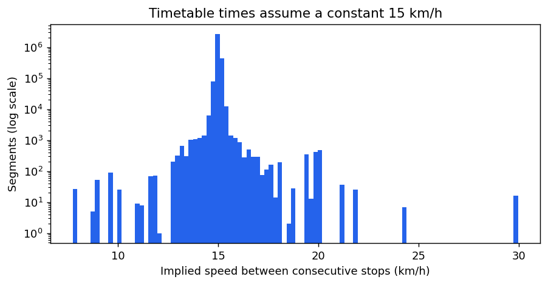
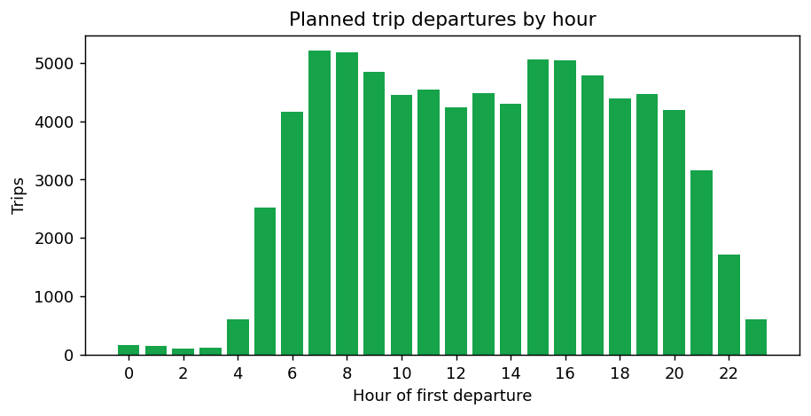
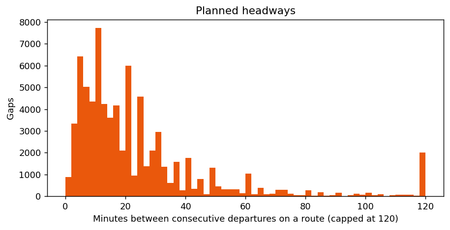
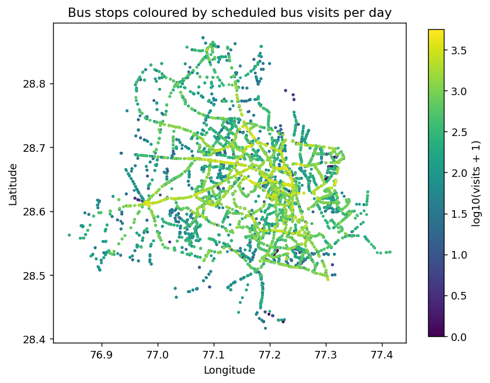

# Static data audit

- **Feed:** Delhi bus GTFS, archived by Transitland and mirrored by [Mobility Database](https://mobilitydatabase.org/feeds/gtfs/mdb-1262) as `mdb-1262`.
- **Snapshot date:** The files inside the archive were last modified between November 2022 and February 2023.
- **Reproduce:** Run `python scripts/explore_static.py`. It writes the figures and [`static_summary.json`](static_summary.json).

## Why the archive and not the portal

- On 21 October 2026, the portal's download form accepted the submission for all eight bus and metro files, but every download returned HTTP 404.
- The older IIIT-Delhi file server linked from the portal timed out.
- The archive is the most recent public copy found. Newer routes and stops added since early 2023 will be missing.

## Contents

| Item | Count |
| --- | --- |
| Routes | 2,964 (1,964 DIMTS, 1,000 DTC) |
| Route names without the UP or DOWN suffix | 1,312 |
| Stops | 6,342, of which 75 are never served |
| Trips per day | 78,515 |
| Stop time rows | 3,276,092 |
| Calendars | 1, covering every day from 2022 to 2024 |
| Route shapes | None |

## Key findings

### 1. Travel times in the timetable are synthetic

- Dividing the straight-line distance between consecutive stops by the scheduled time gives the same speed almost everywhere.
    - The median implied speed is 15.01 km/h.
    - The 1st and 99th percentiles are 14.78 and 15.25 km/h.
- This confirms the portal's warning that arrival times assume a constant speed.
- **Consequence:** The timetable cannot be used to measure delay or real travel time. Only the live feed can.

### 2. Trip start times look like a real plan

- Departures rise from 4 am, peak at about 5,200 trips per hour at 7 and 8 am, dip slightly around midday and peak again at 3 to 4 pm.
- Only 126 of 2,759 routes with more than one trip have perfectly even gaps. A generated timetable would usually be far more regular.
- **Consequence:** Planned frequency by route and hour is a fair analysis, as long as it is described as the plan, not observed service.

### 3. Planned headways vary widely

- The most common gaps between departures on a route are 5, 10, 20 and 24 minutes.
- About 2,000 gaps are two hours or more, which points to routes with very few trips.
- The median route has 18 trips per day, and the busiest has 170.

### 4. Busy corridors stand out clearly

| Busiest stops | Scheduled bus visits per day |
| --- | --- |
| Jahangir Puri Metro Station | 5,591 |
| Anand Vihar ISBT Main Road | 4,865 |
| Adarsh Nagar / Bharola Village | 4,699 |
| Super Bazar | 4,622 |
| Guru Govind Singh University (Kashmere Gate) | 4,502 |

### 5. Data quality issues

- **Zero-time segments:** 30,025 consecutive stop pairs have the same scheduled time.
- **Long gaps between stops:** The median distance between consecutive stops is 475 m, the 95th percentile is 1.2 km, and the longest is 37 km. The longest gaps need checking for data errors.
- **Repeated stop names:** 2,627 stop names appear more than once, mostly stops on opposite sides of the same road. Stop IDs, not names, must be used for joins.
- **No route shapes:** Road geometry must come from map matching against OpenStreetMap.
- **Route names are codes:** Names such as `764MSTLDOWN` combine the route number, a variant and the direction. `route_short_name` is empty.

## What this data supports now

- Network maps of routes, stops and busy corridors.
- Planned frequency by route, corridor and hour.
- Stop coverage, for example the share of an area within 500 m of a stop, once a city boundary or population grid is added.
- Bus and metro connections, once metro GTFS is available.
- A stop and route reference table for matching live bus positions later.

## What it cannot support

- Delay, travel time or speed analysis. These need the live feed.
- Claims about service in 2026, because the snapshot is from early 2023.
