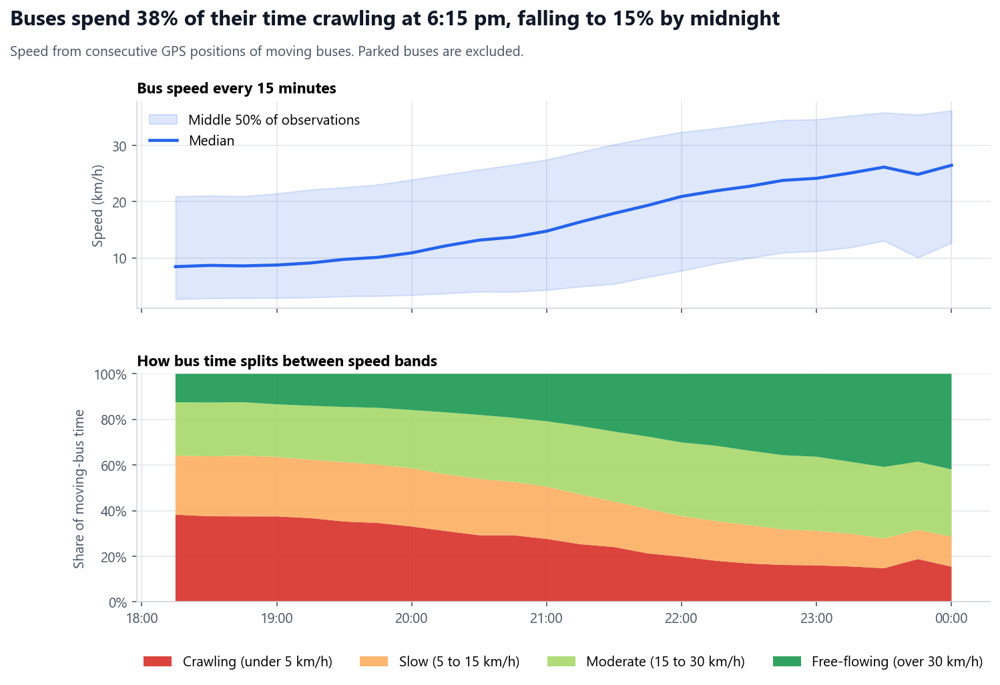
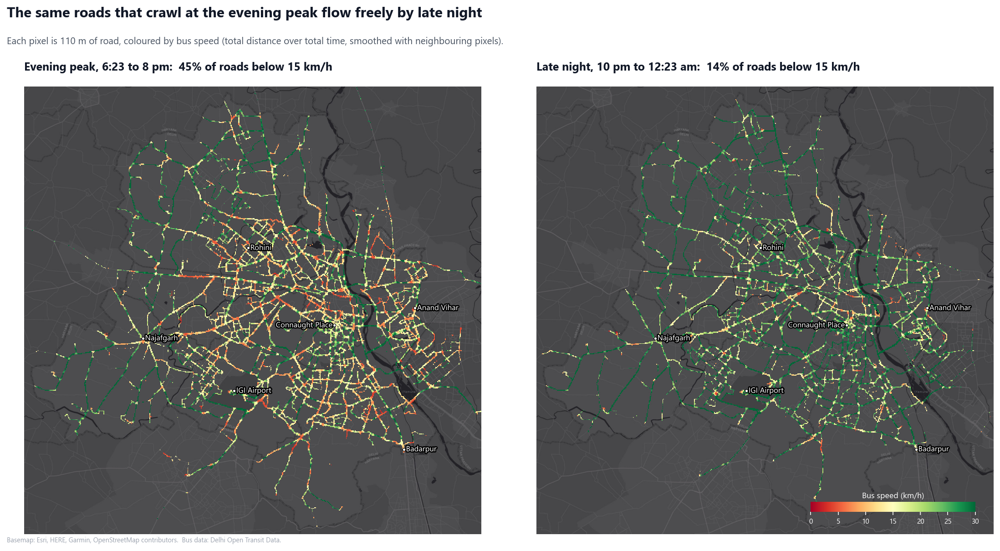
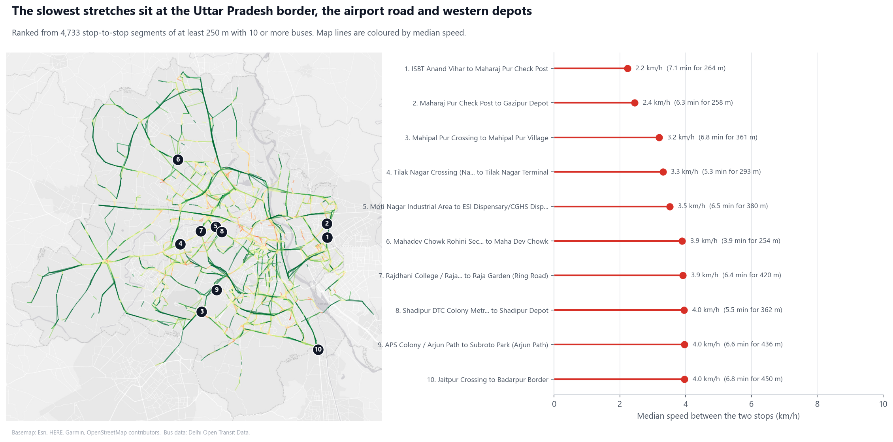
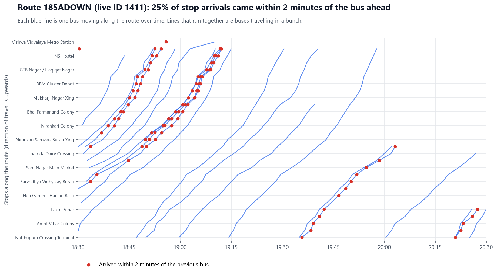
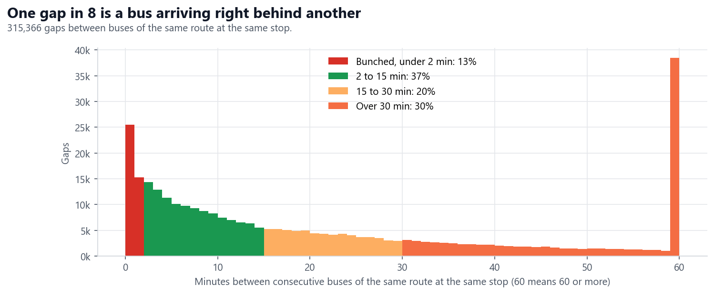
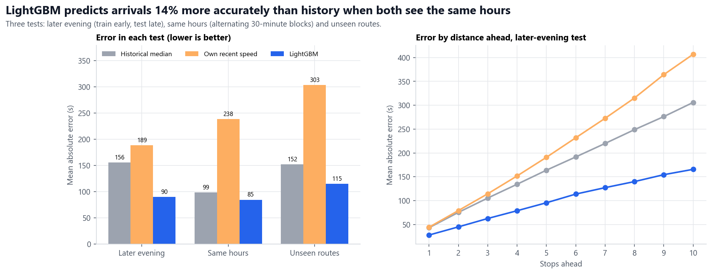
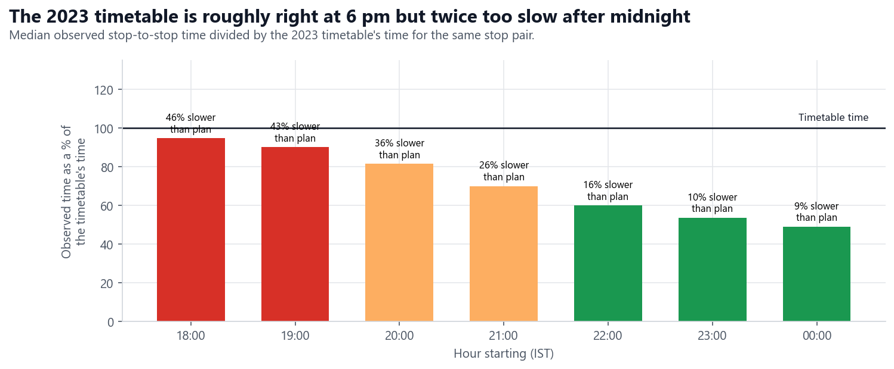
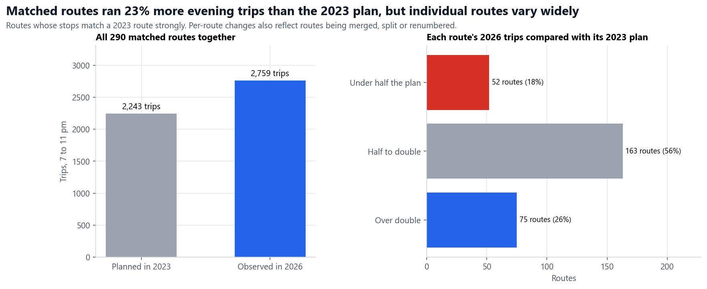
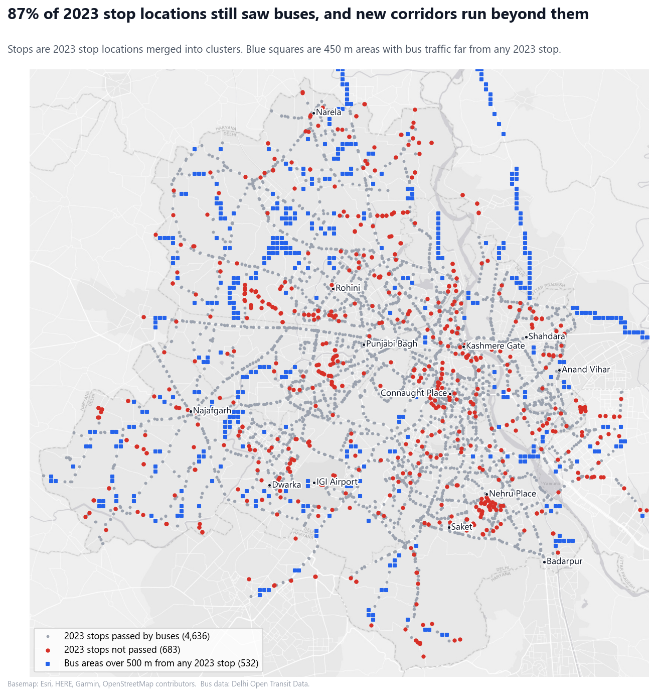

# Findings: one evening of Delhi bus movement

- **Data:** Live bus positions from Delhi Open Transit Data, polled every 10 seconds on 21 October 2026 from 6:23 pm to 12:23 am IST.
- **Scale:** 5.08 million positions from 6,065 buses on 24,030 trips.
- **Reproduce:** Run the scripts in the order listed in the [README](../README.md).

## Headline results

| Question | Answer |
| --- | --- |
| How fast are buses in the evening peak? | Median 8.6 km/h from 6 to 7 pm, rising to 26 km/h after midnight |
| Where are they slowest? | The Anand Vihar to Gazipur border stretch, Mahipalpur on NH-48, Moti Nagar, Raja Garden and Shadipur, all at 2 to 4 km/h |
| Do buses on the same route bunch? | Yes. 13% of gaps between consecutive buses are under 2 minutes, and gaps vary about as much as random arrivals would |
| Can arrival times be predicted? | Yes. A LightGBM model beats the historical median by 14% when both use the same hours, and by 24% on routes it has never seen |
| How does 2026 compare with the 2023 timetable? | The timetable's flat 15 km/h matches the 6 pm peak but is twice as slow as reality after midnight. Matched routes ran 23% more evening trips than planned in 2023 |

## 1. Speed falls sharply in the evening peak

| Hour starting | Median speed (km/h) | Buses reporting |
| --- | --- | --- |
| 18:00 | 8.6 | 5,608 |
| 19:00 | 9.4 | 5,676 |
| 20:00 | 12.4 | 5,537 |
| 21:00 | 17.0 | 4,978 |
| 22:00 | 22.1 | 3,586 |
| 23:00 | 24.9 | 1,965 |
| 00:00 | 26.2 | 748 |

- Buses move about three times faster after midnight than at 6 pm.
- 30% of moving-bus observations were below 5 km/h across the whole evening.
- Speeds include time at stops and signals, and exclude buses parked at depots or terminals.

## 2. The slowest corridors

| From | To | Distance (m) | Buses | Median time (s) | Median speed (km/h) |
| --- | --- | --- | --- | --- | --- |
| ISBT Anand Vihar | Maharaj Pur Check Post | 264 | 15 | 426 | 2.2 |
| Maharaj Pur Check Post | Gazipur Depot | 258 | 14 | 379 | 2.4 |
| Mahipal Pur Crossing | Mahipal Pur Village | 361 | 41 | 407 | 3.2 |
| Tilak Nagar Crossing (Najafgarh Road) | Tilak Nagar Terminal | 293 | 11 | 319 | 3.3 |
| Moti Nagar Industrial Area | ESI Dispensary | 380 | 45 | 388 | 3.5 |
| Rajdhani College / Raja Garden | Raja Garden (Ring Road) | 420 | 55 | 386 | 3.9 |
| Shadipur DTC Colony Metro Station | Shadipur Depot | 362 | 115 | 330 | 4.0 |
| APS Colony / Arjun Path | Subroto Park | 436 | 56 | 396 | 4.0 |
| Jaitpur Crossing | Badarpur Border | 450 | 18 | 408 | 4.0 |

- **Coverage:** 244,147 stop-to-stop trips over 11,208 segments. 4,733 segments of at least 250 m with at least 10 buses are ranked.
- **Typical speed:** The median segment speed is 19.4 km/h.
- **Hotspots:** The slow segments cluster around the eastern border with Uttar Pradesh, the airport approach, the Ring Road in the west and central Delhi.
- **Caution:** Some slow segments end at a depot or terminal, so part of their time may be queuing to enter.

## 3. Buses bunch instead of running at even gaps

- **Data:** 315,366 gaps between consecutive buses of the same route at the same stop, on 631 routes with at least 6 buses.
- **Bunching:** 13% of gaps are under 2 minutes, which usually means two buses of the same route arriving together.
- **Irregularity:** The median route's coefficient of variation of gaps is 0.94. Evenly spaced service would be near 0, and random arrivals give 1.
- **Long gaps:** Gaps of an hour or more are also common, partly from low-frequency routes and partly from service thinning late at night.

## 4. Arrival-time prediction

- **Task:** When a bus reaches a stop, predict when it will reach each of its next 1 to 10 stops.
- **Examples:** 1.33 million, with a median actual travel time of 417 seconds.
- **Baselines:**
    - The historical median for the route, stop and horizon, falling back to the stop alone, then to distance at the typical speed.
    - The bus's own recent speed over its last three stops.

### Three tests

| Test | How the data is split | Why |
| --- | --- | --- |
| Later evening | Train on 6:23 to 9:46 pm, test on 9:46 pm to 12:23 am | Mimics predicting the future, but the test hours have lighter traffic |
| Same hours | Alternate 30-minute blocks, with each example inside one block | Train and test cover the same times of evening |
| Unseen routes | Hold out a random quarter of routes | Tests whether the model works on routes it has never seen |

| Test | Historical median MAE (s) | Own recent speed MAE (s) | LightGBM MAE (s) | LightGBM within 120 s | Gain over best baseline |
| --- | --- | --- | --- | --- | --- |
| Later evening | 155.8 | 188.6 | **89.9** | 75.8% | 42% |
| Same hours | 98.8 | 238.3 | **84.6** | 77.1% | 14% |
| Unseen routes | 151.7 | 303.3 | **115.2** | 67.1% | 24% |

- **The headline gain is mostly a time-of-day effect.** In the later-evening test, the baseline uses peak-hour history for lighter late-night traffic. LightGBM knows the hour, so it adjusts.
- **With fair history, the gain is modest.** When both methods see the same hours, LightGBM is 14% better than the historical median.
- **The model generalises.** On routes it has never seen, it is 24% better, because it learns from distance, stops and live speeds rather than memorised route history.
- **Error grows with distance.** In the later-evening test, error rises from 28 s one stop ahead to 166 s ten stops ahead, against 43 s and 306 s for the historical median.
- **Useful inputs:** Distance (37% of total gain), starting stop (27%), horizon (16%), route (13%) and live speed from other buses on the next segment (5%).
- **The bus's own recent speed added almost nothing,** which suggests a bus's last few stops say little about its next ones.
- **Test sizes differ.** The same-hours test only uses examples that fit inside one 30-minute block, so it has fewer long horizons and lower errors overall. Compare methods within a test, not across tests.

## 5. Comparison with the 2023 timetable

- **Data:** The archived 2023 timetable, matched to this evening through shared stop locations.
- **Caution:** The two snapshots are about three and a half years apart, so differences show change since 2023, not service failures.

### 5.1 The timetable's travel times are wrong in both directions

- The 2023 timetable assumes 15 km/h everywhere. This compares its stop-to-stop times with observed times on the same 4,967 stop pairs, over 174,844 bus trips.

| Hour starting | Observed time / timetable time | Share of trips slower than the timetable |
| --- | --- | --- |
| 18:00 | 0.95 | 46% |
| 19:00 | 0.90 | 43% |
| 20:00 | 0.81 | 36% |
| 21:00 | 0.70 | 26% |
| 22:00 | 0.60 | 16% |
| 23:00 | 0.54 | 10% |
| 00:00 | 0.49 | 9% |

- **At the evening peak,** the timetable is close on average, but 46% of trips take longer than it says.
- **After midnight,** buses take about half the time the timetable shows.
- **Consequence:** An app that used the published timetable would be wrong in both directions: too optimistic for many trips at the peak and too pessimistic later.

### 5.2 Live routes can be linked to 2023 route names

| Match quality | Rule | Live routes |
| --- | --- | --- |
| Strong | At least 70% of the live route's stops are on one 2023 route, with an overlap (Jaccard) of at least 0.5 | 368 |
| Partial | At least 50% of its stops are on one 2023 route | 798 |
| None | Below 50% | 255 |

- **Examples of strong matches:**
    - Live route 1600 matches 2023 route `145UP` (Jaccard 0.88).
    - Live route 448 matches `359UP` (0.85).
    - Live route 1925 matches `428DOWN` (0.84).
- **Renumbering:** No live route ID equals its matched 2023 route ID, so route IDs were renumbered after 2023.
- **Route changes:** Partial and unmatched routes are likely new, merged or restructured since 2023.

### 5.3 Evening service on matched routes

- **Coverage:** 290 strongly matched routes had planned 2023 departures between 7 and 11 pm.
- **Totals:** They ran 2,759 trips this evening against 2,243 planned in 2023, or 23% more.
- **Wide spread per route:**
    - The middle half of routes ran 0.6 to 2.1 times their 2023 plan.
    - 18% ran less than half.
    - 51% ran more than planned.
- **Caution:** The per-route spread probably reflects routes being merged, split or renumbered, as much as real changes. Only the overall total is a fair summary.

### 5.4 Network footprint

- **Stops:** 4,636 of 5,319 stop locations from 2023 (87%) were passed by at least three buses this evening.
- **Not passed:** The 683 stops not passed cluster in central Delhi. They may have moved, been dropped or simply had no evening service.
- **Areas far from 2023 stops:** 532 of 3,920 areas with bus traffic are more than 500 m from any 2023 stop.
    - Some are long road stretches out of Delhi, towards Ghaziabad in the east and Sonipat in the north.
    - Others lie in the outer north and west.
    - These may be new routes or long gaps between stops, which this data cannot separate.

### 5.5 Fleet registration series

| Plate series | Buses | Share |
| --- | --- | --- |
| DL1PD | 4,144 | 68% |
| DL51EV | 1,157 | 19% |
| DL51GD | 646 | 11% |
| DL1PE | 118 | 2% |

- The `DL51EV` series name suggests electric buses, but this was not verified against an official fleet list.

## How the data was built

| Step | Method | Result |
| --- | --- | --- |
| Clean positions | Removed duplicates, positions more than 5 minutes old, GPS jumps above 80 km/h and gaps over 2 minutes | 3.63 million usable movement steps |
| Remove parked buses | A bus that stays within 60 m for 5 minutes is parked | 1.40 million positions marked as parked |
| Merge duplicate stops | Joined stop records within 60 m that face the same direction | 6,267 stops became 5,319 stop clusters |
| Detect stop passages | Projected each movement onto stops within 35 m, heading the same way as the stop | 483,177 passages |
| Rebuild routes | Ordered each route's stops by median time since trip start | 1,421 routes with a median of 31 stops |
| Check route order | Compared each trip's actual stop order with its rebuilt route | Median rank correlation 0.99 |
| Remove halts | Dropped stop-to-stop hops over 10 minutes, such as terminal layovers | 19,989 halts removed |

## Limitations

- **One evening only.** No further collection is planned. Results describe a single weekday evening, and the model cannot be tested on other days.
- **Different years.** The 2023 timetable and the 2026 live feed are about three and a half years apart, so comparisons show change since 2023, not service failures.
- **Straight-line distances.** Segment lengths are measured in a straight line between stops, so road speeds are slightly understated.
- **2023 stop locations.** Stops added or moved since early 2023 are missing, so some passages are not detected.
- **Route names are inferred.** Only 368 live routes match a 2023 route strongly. The rest have no reliable name.
- **Halt threshold.** Treating hops over 10 minutes as halts may also remove a few genuine severe jams.

## Next steps without more collection

- Match bus paths to OpenStreetMap roads to measure true road distances.
- Ask the portal team for the current timetable, then recheck the route names and the frequency comparison.
- Build a replay map of this evening that shows speeds, bunching and predicted arrivals over time.
